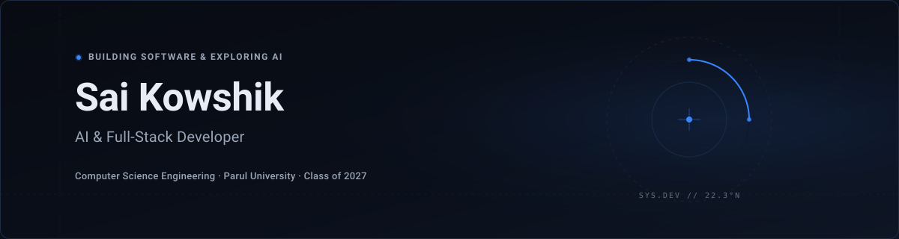

  

 

Hi, I'm Sai Kowshik, a Computer Science Engineering student at Parul University, graduating in 2027. I enjoy building full-stack applications, exploring AI-powered software, and learning through practical projects.

[Portfolio](https://splendid-meerkat-9288a0.netlify.app/) &nbsp;·&nbsp; [LinkedIn](https://linkedin.com/in/venkata-sai-kowshik-boddu) &nbsp;·&nbsp; [Email](mailto:kowshik.bvs@gmail.com)

---

### Focus & Technologies

- **Languages:** Java, Python, JavaScript, SQL
- **Development:** React, Node.js, Express, REST APIs
- **Data:** MongoDB, SQL
- **Interests:** AI applications, LLMs, backend development, and software engineering

---

### Featured Projects

#### [Collabrix](https://github.com/kowshik568/Collabrix-)
A collaborative platform designed to help early-career developers find peers with complementary skill sets, organize cross-functional workspaces, and build practical projects together.
- **Stack:** React, Node.js, Express, MongoDB, RESTful APIs
- **Repository:** [github.com/kowshik568/Collabrix-](https://github.com/kowshik568/Collabrix-)

#### AI Resume Analyzer
An intelligent ATS diagnostic tool that parses resume text against target job descriptions, computes match alignment, and highlights missing keywords through structured LLM outputs.
- **Stack:** React, Node.js, Express, MongoDB, OpenAI API
- **Repository:** [github.com/kowshik568](https://github.com/kowshik568)

#### Smart Job Portal
A full-stack recruitment portal featuring dual candidate and recruiter workspaces, role-protected routes, and Cloudinary-backed resume document management.
- **Stack:** React, Node.js, Express, MongoDB, JWT Auth, Cloudinary
- **Repository:** [github.com/kowshik568](https://github.com/kowshik568)

---

### Verified Highlights

- **TCS CodeVita Season 13:** Global Rank 4014 worldwide in algorithmic problem solving
- **AWS Cloud Quest:** Cloud Practitioner certification challenge
- **UnitedMentor:** Full-Stack Development Intern (May 2026 – Aug 2026)

---

Vadodara, India &nbsp;·&nbsp; [github.com/kowshik568](https://github.com/kowshik568)
